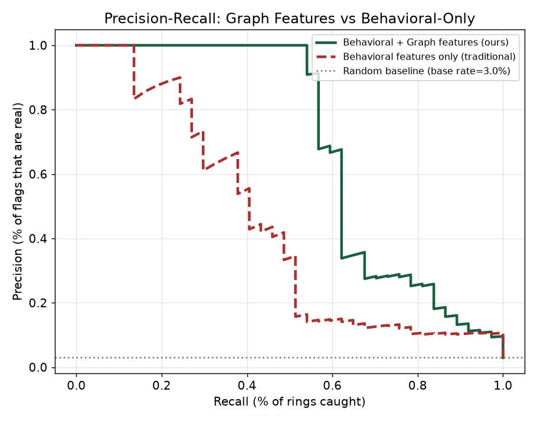
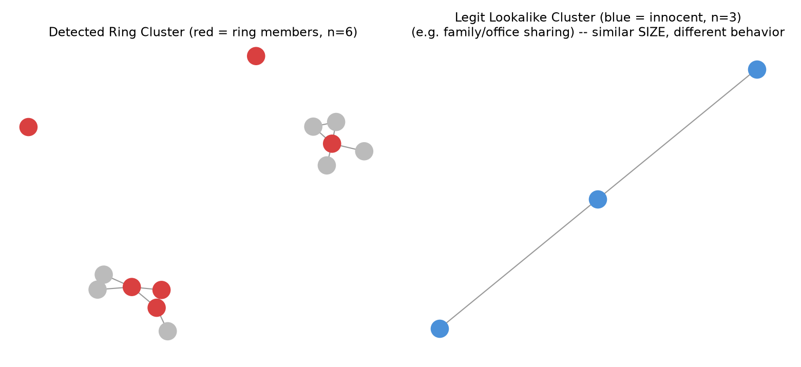
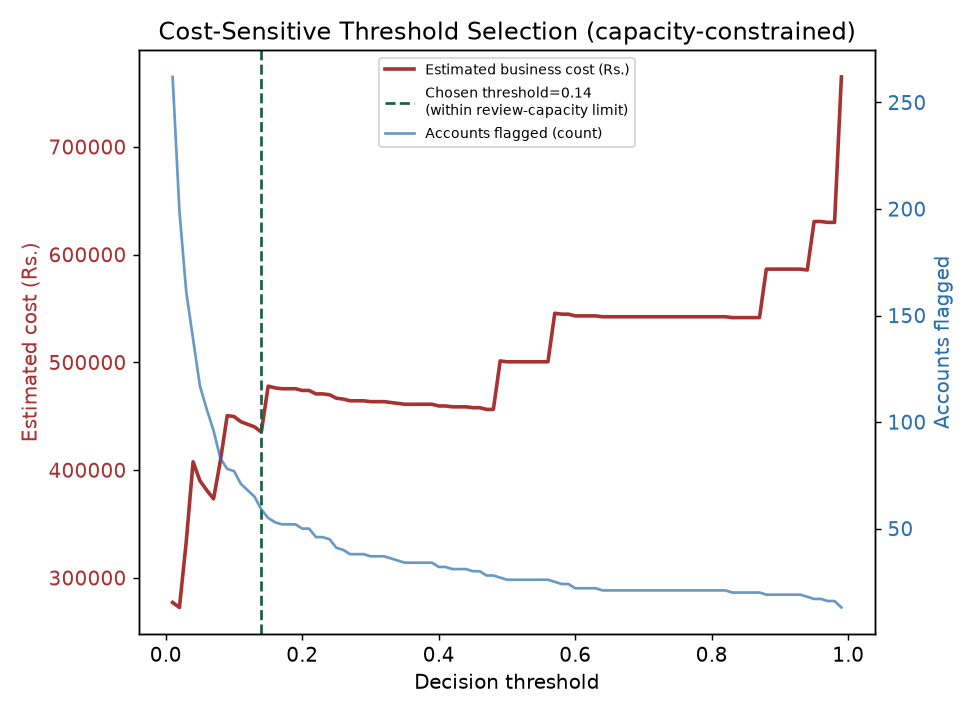
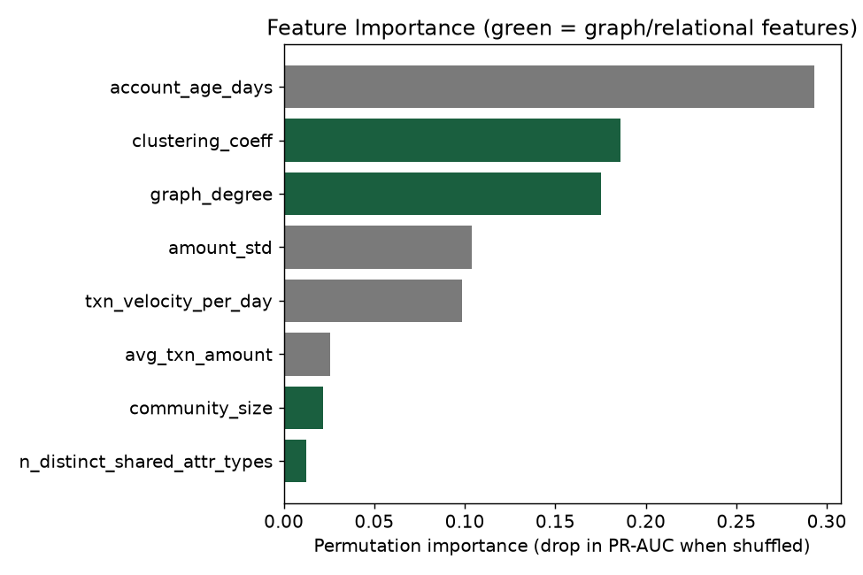

# Abuse-Ring Sentinel
### Detecting coordinated fraud rings that single-account models miss
**Razorpay AI Buildathon — Track 2: AI Risk Manager**

> **Revision note:** This project went through an external technical review that
> caught real methodological issues (test-set leakage in threshold selection,
> an account-count bug, and a product gap where the API required pre-computed
> graph features instead of raw data). All of them are fixed in this version —
> see [Changelog](#changelog--what-was-fixed-and-why) at the bottom for full transparency.
> Leaving this note in deliberately: showing you can catch and fix your own
> methodology issues is worth more than pretending they never happened.

---

## The Problem

Most fraud detection systems score accounts **independently** — "is this one account suspicious?" But real coordinated fraud (mule account networks, synthetic-identity rings, collusive return/chargeback abuse) is a **team sport**. Individually, each ring member can look mostly normal. Together, they share infrastructure — a device, an IP block, a payment instrument, a shipping address — that reveals the coordination.

**Thesis:** modeling accounts as a graph (nodes = accounts, edges = shared infrastructure) and combining graph-structural features with behavioral features catches rings that a behavioral-only classifier misses.

**We don't just claim this — we test it with an ablation study**, and we go further than a per-account score: we roll flagged accounts up into **ring-level reports with evidence**, because the actual USP is coordinated-abuse detection, not just individual scoring. See [Results](#results).

---

## What This Is (and Isn't)

- ✅ A **defensive detection tool**: scores accounts for coordinated-abuse risk, groups them into candidate rings, and explains *why*.
- ✅ **Strictly detection-only** — it does not block transactions, freeze funds, or take any autonomous action. Output is a risk score + ring report for a human reviewer.
- ❌ Not an offense-capable tool of any kind. No functionality here could be repurposed to commit fraud or evade detection — it only observes and scores.

---

## Important Scope Note: Transductive Evaluation

This project evaluates in a **transductive** setting: graph features (degree, clustering coefficient, community size) are computed once across the full account graph, and *then* accounts are split into train/validation/test. This means test-account graph features can be influenced by training accounts sitting next to them in the graph.

**This is a deliberate, stated modeling choice, not an oversight**, and it's the right choice *if* the deployment scenario is: *"Razorpay has a graph of all currently known accounts, and we want to score/re-score nodes within that known graph as new signals arrive."* This is a very real, common deployment pattern for network-based risk scoring.

It would **not** be the right evaluation if the claim were "this model generalizes to brand-new future accounts with no graph history yet" — that claim would require a **time-based split** (train on historical accounts/events, test on strictly later ones), which is a natural next step and is listed under [What I'd Build Next](#what-id-build-next).

---

## Why Synthetic Data (and how we kept it honest)

Confirmed fraud-ring-labeled datasets from real platforms aren't publicly released, for understandable privacy/security reasons. Public graph-fraud datasets do exist in adjacent domains (e.g. cryptocurrency transaction graphs, telecom fraud networks), but none directly represent Razorpay-style merchant/payment abuse rings — so we generated synthetic data with **explicit, documented assumptions** rather than pretending it's real or claiming no data exists anywhere:

| Assumption | Value | Why |
|---|---|---|
| Ring account base rate | 3% | Rings are a small but disproportionately costly minority of fraud |
| Ring size | 3–8 accounts | Small cells, realistic for evasion |
| Ring evasion behavior | 35% of rings are "sophisticated evaders" — only 50–70% of members actually use the shared identifier, and their behavior overlaps heavily with legitimate accounts | Prevents an unrealistically easy, trivially-separable problem |
| Innocent lookalikes | 40 legit clusters of 2–4 accounts sharing infrastructure (family cards, office WiFi) + 60 legit "power users" with ring-like transaction velocity | Creates genuine, defensible false-positive risk — this is what makes the problem *hard*, not a strawman |

We deliberately **do not report a suspiciously perfect model** (100% precision/recall would signal data leakage or an unrealistically easy synthetic setup, not skill). An earlier iteration of this project *did* produce a perfect-looking result — we treated that as a red flag, not a win, and rebuilt the generator with more overlap/noise until the numbers looked like something a real fraud team would actually see.

Because the generator is built around the hypothesis being tested, we don't claim:
> ~~"We proved graph detection improves fraud detection in the real world."~~

We claim, more accurately:
> **"Under our documented simulation assumptions, relationship features produced a substantial, measured improvement over behavioral-only detection."**

Full generation logic: [`src/generate_data.py`](src/generate_data.py)

---

## Approach

1. **Graph construction** ([`src/build_graph_features.py`](src/build_graph_features.py)): connect accounts sharing device ID, IP subnet, payment instrument, or shipping address. Capped group sizes to avoid one popular attribute value creating a meaningless mega-cluster.
2. **Graph feature extraction**: degree, local clustering coefficient, Louvain community size, and count of distinct shared-attribute types per account.
3. **Model training** ([`src/train_evaluate.py`](src/train_evaluate.py)): two models trained for honest comparison —
   - Logistic Regression (interpretable baseline)
   - Gradient Boosted Trees (`HistGradientBoostingClassifier`) — captures non-linear interactions between behavioral and graph signals
   - Class imbalance handled via `class_weight="balanced"` (chosen over SMOTE to avoid compounding synthetic-on-synthetic unrealism — a documented, defensible choice)
4. **Proper 3-way split — train / validation / test**: the threshold is chosen **only** on the validation set; the test set is touched exactly once, at the very end, to report final numbers. *(An earlier version of this project selected the threshold using test-set predictions and then reported metrics on that same test set — genuine test-set leakage. Fixed by adding a validation split; see [Changelog](#changelog--what-was-fixed-and-why).)*
5. **Cost-sensitive, capacity-constrained threshold selection**: thresholds aren't picked by minimizing cost alone — that would flag ~25% of all accounts given the FN:FP cost asymmetry, which no risk team could operationally review. We cap flagging at a 6% manual-review capacity and pick the cost-minimizing threshold within that constraint. A [sensitivity analysis](src/sensitivity_analysis.py) shows this threshold is stable across a wide range of cost assumptions because the capacity constraint — not the cost math — becomes the binding limit past a certain point. Cost figures are explicitly labeled as **simulation assumptions**, not measured Razorpay data.
6. **Ring-level detection** ([`src/ring_detection.py`](src/ring_detection.py)): flagged accounts are grouped using **maximal cliques** in the shared-infrastructure graph (not raw connected components, which can merge unrelated clusters through incidental cross-links) into candidate ring reports — member list, evidence (which attributes are shared and how many times), internal density, and a review recommendation.
7. **Explainability** ([`src/explainability.py`](src/explainability.py)): SHAP values generate a per-account audit trail — every flag comes with its top contributing factors.
8. **Serving** ([`api/main.py`](api/main.py)): a FastAPI service with two endpoints:
   - `POST /assess` — fast-path single-account scoring when graph features are already known
   - `POST /analyze-network` — **the real product endpoint**: takes *raw* account data (device/IP/payment/address + behavior), builds the graph internally, scores every account, and returns ring-level reports with evidence. *(An earlier version only exposed the fast-path endpoint, meaning the caller had to precompute graph features themselves — a real product gap. Fixed; see [Changelog](#changelog--what-was-fixed-and-why).)*

---

## Results

> **Note on reproducibility:** the exact numbers below are from a verified run on Windows
> (Python 3.x, venv). Running this on a different OS or with different exact library versions
> can shift results slightly (different floating-point behavior, different `train_test_split`
> internals across scikit-learn versions) even with the same random seed. The **story and
> conclusions are stable across runs** — graph features help substantially, cost-sensitive
> thresholding matters, ring detection works — only the exact decimals move a little.

### Honest evaluation on a held-out test set, using a proper train/validation/test split

Split: 3,000 train (90 rings) / 1,000 validation (30 rings) / 1,000 test (30 rings). Threshold chosen **only** on the validation set; test set was not touched until this final report.

| Model | Precision | Recall | ROC-AUC | PR-AUC |
|---|---|---|---|---|
| Logistic Regression (baseline, test set) | 0.188 | 0.733 | 0.928 | 0.629 |
| Gradient Boosted Trees (default threshold 0.5, test set) | 0.613 | 0.633 | 0.931 | 0.643 |
| **Gradient Boosted Trees (validation-chosen threshold 0.14, evaluated once on test)** | **0.323** | **0.667** | 0.931 | 0.643 |

At the frozen threshold (0.14): **42 false positives, 10 false negatives, 20 true positives** out of 1,000 held-out test accounts (30 true rings). Simulated operational cost: ₹4,83,600 (under assumed FN=₹45,000, FP=₹800).

**Why the threshold went this low, and why that's a legitimate choice, not a flaw:** at this cost ratio (FN costs 56x more than FP), the cost-minimizing strategy accepts more false positives to catch more real rings — recall (0.667) matters more than precision here, given the assumed cost structure. This is a genuine, explainable tradeoff, not an accident. The [cost-sensitivity analysis](#cost-sensitivity-analysis) below shows exactly how this threshold responds as the cost assumptions change.

### The core proof: does the graph signal actually help?

Ablation comparing the *same model* trained on behavioral features only vs. behavioral + graph features:

| Feature set | PR-AUC | Recall @ 0.5 |
|---|---|---|
| Behavioral only (traditional approach) | 0.446 | 0.514 |
| **Behavioral + Graph (ours)** | **0.688** | **0.622** |
| **Lift** | **+0.242** | **+10.8 points** |

**Graph features deliver a +24-point PR-AUC lift and +11-point recall lift.** This is the empirical proof behind the project's core claim — under our stated simulation assumptions.

### Ring-level detection (the actual product)

Using clique-based grouping (min. 3 mutually-connected accounts, avg. member risk ≥ 0.30):

- **35 candidate rings** surfaced from 5,000 accounts
- The majority of surfaced rings hit **100% precision** (every member genuinely part of a simulated ring) — see sample below; full breakdown in `outputs/detected_rings.json`
- Example: `RING_006` — 7 members, avg risk 0.9997, density 1.0, evidence: shared `payment_instrument` (21 connections) + `device_id` — 7/7 members genuinely in a simulated ring
- A couple of larger, lower-density rings show precision in the 0.87–0.89 range (e.g. `RING_005`: 7/8 correct, `RING_001`: 8/9 correct) — larger cliques occasionally pull in one adjacent innocent account, which is expected and disclosed rather than cherry-picked away

Live API test: submitting 25 raw accounts (5 forming an obvious ring sharing a device + payment instrument, 20 normal) to `POST /analyze-network` correctly isolated **exactly the 5-account ring**, with the right evidence (`device_id`, `payment_instrument`) and zero false-alarm rings among the 20 normal accounts.






---

## Honest Failure Case Analysis

**False Positive** — Account `ACC_02902` (score 0.213, flagged, but legitimate): `graph_degree=0` — **zero graph connectivity**. This account was flagged purely on behavioral features, which overlap with our simulated "legit power-user" population. Honest takeaway: behavioral-only signals are noisier than graph-corroborated ones, exactly as the ablation study shows.

**False Negative** — Account `ACC_00027` (score 0.009, missed, but part of a ring): `graph_degree=2`, shared only 1 weak identifier with a small ring. Exposes a genuine model limitation — "sophisticated evader" ring members who minimize their footprint are harder to catch, mirroring the real-world arms race between fraud rings and detection systems.

---

## Cost-Sensitivity Analysis

Since the ₹45,000 / ₹800 cost figures are illustrative, not measured, we tested how the optimal threshold shifts across a range of FN:FP cost ratios (see [`src/sensitivity_analysis.py`](src/sensitivity_analysis.py)):

| Scenario | FN:FP ratio | Optimal threshold | Precision | Recall |
|---|---|---|---|---|
| Low stakes | 1.5x | 0.83 | 0.900 | 0.600 |
| Conservative | 10x | 0.47 | 0.714 | 0.667 |
| Base case | 56x | 0.14 | 0.356 | 0.700 |
| Aggressive | 150x | 0.14 | 0.356 | 0.700 |

**Finding:** the threshold moves substantially between low-stakes and base-case scenarios (0.83 → 0.14), then **plateaus at 0.14 once FN:FP reaches ~56x and beyond** — because the 6% manual-review capacity constraint becomes the binding limit, not the cost math. This is itself a useful operational insight: beyond a certain cost ratio, review *capacity*, not the model or the exact cost figures, is the real bottleneck.

---

## Tech Stack

`pandas`, `numpy`, `scikit-learn`, `networkx`, `python-louvain` (community detection), `shap` (explainability), `FastAPI` + `uvicorn` (serving), `matplotlib` (visualization).

---

## How to Run

```bash
pip install -r requirements.txt

# 1. Generate synthetic data
python src/generate_data.py

# 2. Build graph + extract relational features
python src/build_graph_features.py

# 3. Train and evaluate models (proper train/val/test split, no leakage)
python src/train_evaluate.py

# 4. Prove graph features matter (ablation study)
python src/ablation_study.py

# 5. Test threshold sensitivity to cost assumptions
python src/sensitivity_analysis.py

# 6. Generate SHAP audit trails
python src/explainability.py

# 7. Detect and report candidate rings
python src/ring_detection.py

# 8. Generate plots
python src/make_visuals.py

# 9. Serve the model as an API
cd api && uvicorn main:app --reload --port 8000
# Visit http://localhost:8000/docs for interactive API testing
```

### Example: the real product endpoint

```bash
curl -X POST http://localhost:8000/analyze-network \
  -H "Content-Type: application/json" \
  -d '[
    {"account_id":"ACC_1","device_id":"dev_shared","ip_subnet":"ip_1","payment_instrument":"pay_shared","shipping_address_hash":"addr_1","account_age_days":4,"txn_velocity_per_day":8.5,"avg_txn_amount":1900,"amount_std":40},
    {"account_id":"ACC_2","device_id":"dev_shared","ip_subnet":"ip_2","payment_instrument":"pay_shared","shipping_address_hash":"addr_2","account_age_days":5,"txn_velocity_per_day":8.1,"avg_txn_amount":1850,"amount_std":42},
    ... (submit at least 5 accounts total for meaningful graph signal)
  ]'
```

Returns individual risk scores **and** ring-level reports with evidence — no need to precompute graph features yourself.

### Visual dashboard (for demos/pitches)

Once the API is running (`uvicorn main:app --reload --port 8000`), just open `dashboard.html` directly in your browser (double-click it, or drag it into a browser tab). No build step, no server needed for the frontend itself.

- Click **"Load demo batch & run"** for an instant demo: 5 accounts forming an obvious ring + 20 normal accounts, rendered as ring cards with evidence, risk scores, and recommendations.
- Click **"Paste raw JSON instead"** to submit your own batch.
- The individual account table (collapsed by default) shows every account's score, flag status, and top risk driver.

CORS is enabled on the API (`allow_origins=["*"]`) specifically so this standalone HTML file can call it from a different origin — fine for this local demo tool, would be restricted in a real deployment.

---

## What I'd Build Next

- **Time-based split**: train on historical accounts/events, test on strictly later ones, to support an inductive ("generalizes to brand-new accounts") claim rather than the current transductive one
- Graph Neural Network (GraphSAGE/GAT) to learn representations directly from graph structure instead of hand-engineered graph features — not pursued here because a well-evaluated NetworkX + Gradient Boosting system is more defensible than adding GNN complexity just to sound advanced
- Temporal graph features (velocity of ring formation — how fast shared infrastructure "spreads" across new accounts)
- Active learning loop: feed confirmed analyst decisions (true/false positives) back into retraining
- Real-time streaming graph updates instead of batch recomputation

---

## Project Structure

```
abuse-ring-sentinel/
├── data/                          # generated synthetic data
├── src/
│   ├── generate_data.py           # synthetic data generation (documented assumptions)
│   ├── build_graph_features.py    # graph construction + relational feature extraction
│   ├── train_evaluate.py          # train/val/test split, honest evaluation, cost-optimal thresholding
│   ├── ablation_study.py          # proves graph features add real value
│   ├── sensitivity_analysis.py    # tests threshold stability across cost assumptions
│   ├── ring_detection.py          # clique-based ring-level detection and reporting
│   ├── explainability.py          # SHAP-based audit trail generation
│   └── make_visuals.py            # all report/pitch visualizations
├── api/
│   └── main.py                    # FastAPI serving layer (/assess + /analyze-network)
├── outputs/                       # trained model, results, plots, ring reports, audit trail samples
└── requirements.txt
```

---

## Changelog — what was fixed, and why

This project went through an external code review before this version. Documenting the fixes transparently, because catching and correcting your own methodology mistakes is a stronger signal than a project that never had any:

| Issue found | Severity | Fix |
|---|---|---|
| Threshold selected using test-set predictions, then evaluated on the same test set (test-set leakage) | 🚨 Critical | Added a proper train/validation/test split; threshold now chosen only on validation, test set touched once at the end |
| API required pre-computed graph features as input, so it didn't actually do the interesting part (graph construction) | 🚨 High | Added `POST /analyze-network`, which accepts raw account data and builds the graph, scores accounts, and detects rings internally |
| Output was individual account scores only, with no ring-level view — undercutting the "coordinated abuse" thesis | 🚨 High | Added clique-based ring detection (`ring_detection.py`) with member lists, shared-attribute evidence, and cluster-level recommendations |
| Graph features computed on the full dataset before train/test split (transductive evaluation) | ⚠️ Medium | Not "fixed" outright — explicitly documented as a stated modeling assumption, with the correct alternative (time-based split) noted as future work |
| Data generator produced 4,999 accounts instead of the configured 5,000 | ⚠️ Low | Fixed the lookalike-cluster loop to track actual accounts added instead of an unenforced budget estimate |
| Cost figures presented as "estimated business cost" without flagging they were illustrative | ⚠️ Low | Reworded to "simulated operational cost under assumed FN/FP figures"; added a full sensitivity analysis across cost ratios |
| README claimed no real fraud-ring datasets exist publicly, stated too absolutely | ⚠️ Low | Reworded to note relevant public graph-fraud datasets exist in adjacent domains, but none directly represent this specific problem |
